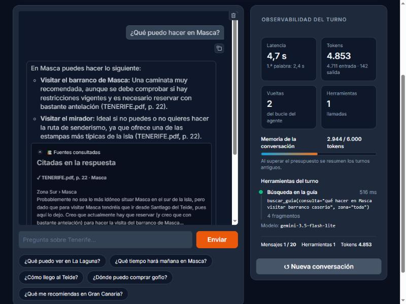

# Asistente turístico de Tenerife

Asistente conversacional que responde preguntas sobre Tenerife a partir de una
guía turística en PDF. Combina:

- **RAG**: búsqueda semántica sobre la guía, con la página citada en cada
  dato.
- **Diálogo multiturno**: memoria de la conversación con presupuesto de
  tokens.
- **Function calling**: pronóstico del tiempo (`get_weather`, Open-Meteo) y
  rutas en Google Maps, coordinados por un agente propio.
- **App web** con streaming y panel de observabilidad:
  **https://asistente-tenerife.onrender.com/** (acceso con usuario y
  contraseña, facilitados en la entrega; la primera visita puede tardar un
  minuto en despertar el servicio).

Proyecto final de la asignatura *Large Language Models* del Máster en IA,
Cloud Computing y DevOps (Pontia).

| Entregable | Dónde |
|---|---|
| Notebook principal | [`notebook/asistente_tenerife.ipynb`](notebook/asistente_tenerife.ipynb) |
| Informe final | [`docs/informe.pdf`](docs/informe.pdf) ([versión Markdown](docs/informe.md)) |
| Decisiones técnicas (D1–D13) | [`docs/decisiones.md`](docs/decisiones.md) |
| App web | https://asistente-tenerife.onrender.com/ ([despliegue](deploy/README.md)) |

## Stack

| Pieza | Elección |
|---|---|
| LLM | Google Gemini `gemini-3.5-flash-lite` (razonamiento `MINIMAL`, respaldo automático a modelos Flash) con el SDK `google-genai` |
| Embeddings | Gemini Embedding 2, 768 dimensiones, asimétricos |
| Base de datos vectorial | Chroma (local, persistente, distancia coseno) |
| Chunking | Propio, un fragmento por sitio de la guía (comparado con tamaño fijo y LangChain) |
| Herramientas | `buscar_guia` (RAG), `get_weather` (Open-Meteo, sin clave), `como_llegar` (Google Maps) |
| Validación | Pydantic (esquemas JSON de las herramientas y salida del juez) |
| Interfaz | Gradio, desplegada en Render |

## Arquitectura

```
Usuario ──► app.py (Gradio) ──► Agente (src/agent.py) ──► Gemini Flash-Lite
                                  │  system prompt con reglas y fecha de hoy
                                  │  bucle LLM → herramientas → LLM (máx. 4 vueltas)
                                  │  memoria con presupuesto de 6.000 tokens
                                  ▼
             buscar_guia ─► Chroma (20 fragmentos, uno por sitio)
             get_weather ─► Open-Meteo (16 lugares, validación Pydantic, log JSONL)
             como_llegar ─► enlace de Google Maps
```

| Módulo | Responsabilidad |
|---|---|
| `src/config.py` | Todos los parámetros (modelo, RAG, memoria, agente, tiempo, app) |
| `src/llm.py` | Cliente de Gemini: reintentos, modelos de respaldo, streaming, errores legibles |
| `src/loader.py` · `src/chunking.py` | Lectura y limpieza del PDF; tres estrategias de chunking |
| `src/embeddings.py` · `src/rag.py` | Embeddings y búsqueda en Chroma con filtros por zona |
| `src/weather.py` · `src/tools.py` · `src/tool_log.py` | Herramientas con esquema Pydantic, ejecución segura y registro |
| `src/prompts.py` · `src/memory.py` · `src/agent.py` | Reglas del asistente, memoria en tres niveles y bucle del agente |
| `src/evaluation.py` · `src/judge.py` | Evaluación con 36 preguntas y juez LLM validado |
| `src/trace_view.py` · `app.py` | Panel de observabilidad y app web |

## Resultados

Evaluación con 36 preguntas fijas (`eval/preguntas.jsonl`): guía, datos que
la guía no tiene, fuera de dominio, tiempo, rutas, *prompt injection* y
seguimiento. Detalle en la sección 9 del notebook.

| Recuperación (23 preguntas) | recall@1 | recall@4 | MRR |
|---|---|---|---|
| **Chunking por sitio (elegido)** | **0,91** | 0,96 | **0,93** |
| Tamaño fijo | 0,83 | 0,96 | 0,88 |
| LangChain recursivo | 0,65 | 1,00 | 0,78 |

| Asistente (configuración final, `MINIMAL`) | Resultado |
|---|---|
| Herramienta correcta / lugar y fecha del tiempo | 100 % / 100 % |
| Evidencia recuperada / página citada | 96 % / 96 % |
| Comportamiento correcto (juez) | 100 % |
| Fidelidad / relevancia (juez, 1-5) | 4,97 / 5,00 |
| Latencia mediana | 3,0 s (10,0 s con `LOW`) |

El juez LLM (Flash-Lite) se validó frente a una revisión independiente: 100 %
de acuerdo en fidelidad (±1) y ninguna alucinación aprobada, también fuera de
muestra.

## Estructura

```
asistente-tenerife/
├── app.py          # App web (Gradio)
├── notebook/       # Notebook principal (asistente_tenerife.ipynb)
├── data/           # Guía turística (TENERIFE.pdf)
├── src/            # Código del asistente (módulos reutilizables)
├── eval/           # Conjunto de preguntas y resultados de la evaluación
├── tests/          # Tests automáticos (pytest)
├── docs/           # Decisiones técnicas e informe final
├── deploy/         # Despliegue de la app en Render
├── requirements.txt
└── .env.example    # Plantilla de configuración de la API key
```

## Instalación

Requiere **Python 3.12**.

```bash
python -m venv .venv
.venv\Scripts\activate          # Windows
source .venv/bin/activate       # macOS / Linux
pip install -r requirements.txt
```

Con [uv](https://docs.astral.sh/uv/) es más rápido:

```bash
uv venv --python 3.12
uv pip install -r requirements.txt
```

## Configuración de la API key

1. Consigue una clave gratuita en [Google AI Studio](https://aistudio.google.com/apikey).
2. Copia `.env.example` como `.env` y pega la clave en `GEMINI_API_KEY`.
3. Comprueba la configuración:

```bash
python -m src.config
```

El archivo `.env` está en `.gitignore` y nunca se sube al repositorio.

## Ejecutar el notebook

El notebook principal es `notebook/asistente_tenerife.ipynb`. Se entrega con
las salidas guardadas, así que los resultados se ven sin ejecutarlo.

Para ejecutarlo hay que usar como kernel el entorno virtual del proyecto
(`.venv`), que es donde están instaladas las dependencias:

- **VS Code:** *Select Kernel* → *Python Environments* → `.venv`.
- **Jupyter:** registra el entorno una vez y elige *Python (asistente-tenerife)*
  en *Kernel → Change kernel*:

```bash
python -m ipykernel install --user --name asistente-tenerife --display-name "Python (asistente-tenerife)"
jupyter lab notebook/asistente_tenerife.ipynb
```

La primera celda añade la raíz del repositorio a la ruta de importación, de
modo que el notebook usa los módulos de `src/`. Sin clave de Gemini, las
celdas que llaman a la API muestran un aviso y el resto funciona.

## App web



- **Chat en streaming**: la respuesta aparece palabra a palabra.
- **Fuentes desplegables** bajo cada respuesta: los fragmentos de la guía
  citados (con su texto), los datos externos (tiempo, ruta) y, aparte, lo que
  la búsqueda recuperó pero la respuesta no usó.
- **Panel de observabilidad**: latencia, tokens, vueltas del agente, uso de
  la memoria frente a su presupuesto y cada herramienta con sus argumentos,
  su resultado y su duración.
- **Ejemplos** que se preguntan con un clic y una conversación propia por
  visitante.

Para arrancarla en local (con la clave en `.env`):

```bash
python app.py
```

y abrir http://127.0.0.1:7860.

### Despliegue

La app está desplegada en Render como *Web Service* gratuito, con acceso por
usuario y contraseña (`APP_USER` y `APP_PASSWORD`) y la clave de Gemini como
secreto del servicio. Los pasos y la configuración están en
[`deploy/README.md`](deploy/README.md).

Límites de la demo (`AppConfig` en `src/config.py`): 20 mensajes por
conversación, 500 caracteres por mensaje y 2 peticiones a la vez.

## Evaluación y tests

Repetir la evaluación (los resultados se guardan en `eval/resultados/` y se
reutilizan; unas 250 peticiones a la API):

```bash
python -m src.evaluation --paso todo --thinking MINIMAL
```

Tests (113, sin llamadas a la API) y estilo PEP 8:

```bash
pytest
ruff check .
```
