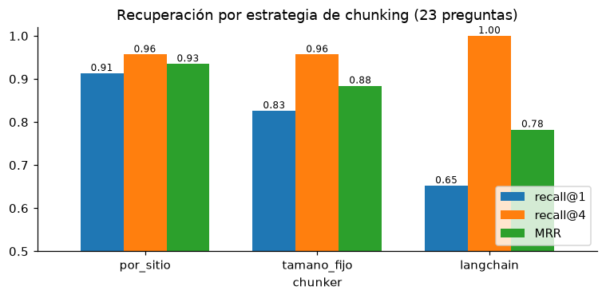
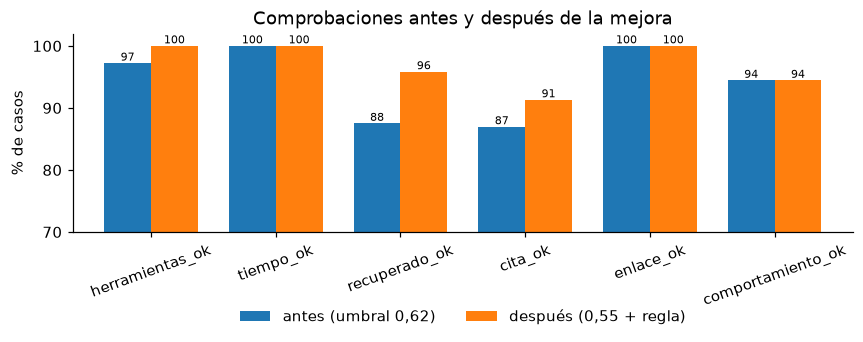
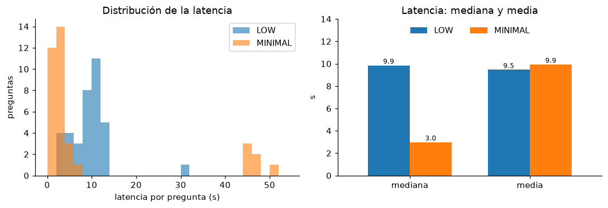

# Asistente turístico de Tenerife — Informe final

**Asignatura:** Large Language Models · Máster en IA, Cloud Computing y DevOps (Pontia)<br>
**Autor:** Jorge El Ferdaoussi García · **Fecha:** 17 de octubre de 2026<br>
**Repositorio:** github.com/jferdaoussi/asistente-tenerife<br>
**App:** https://asistente-tenerife.onrender.com/

## 1. Objetivo y resultado

Asistente conversacional que responde sobre Tenerife a partir de la guía
`TENERIFE.pdf`, cita la página de cada dato, consulta el pronóstico del tiempo
y mantiene el contexto de la conversación. Se entrega como notebook
reproducible (`notebook/asistente_tenerife.ipynb`), código modular en `src/`
con 113 tests, una evaluación con 36 preguntas y una app web desplegada.

| Requisito del enunciado | Dónde se cumple |
|---|---|
| LLM comercial, clave en variables de entorno, parámetros expuestos | Gemini por API; `.env` + `src/config.py`; notebook §1 |
| RAG: chunks, embeddings, vector store, respuestas con cita | Chunking por sitio, Gemini Embedding 2, Chroma; notebook §3-6 |
| Diálogo multiturno con control de longitud | Memoria en tres niveles con presupuesto de tokens; §8 |
| `get_weather` con esquema, ejecución, errores y log | Pydantic → JSON Schema, Open-Meteo, 7 tipos de error, `logs/tools.jsonl`; §7 |
| Evaluación con prompts reproducibles, métricas y gráficos | 36 preguntas, recall@k/MRR, juez LLM validado; §9 |
| Bonus: web, streaming, agentes, observabilidad | App Gradio en Render, streaming, agente con 3 herramientas, panel por turno |

## 2. Diseño de la solución

```
Usuario ─► app.py (Gradio) ─► Agente (src/agent.py) ─► Gemini Flash-Lite
                               │  system prompt: reglas + fecha + calendario
                               │  bucle LLM → herramientas → LLM (máx. 4 vueltas)
                               │  memoria en 3 niveles (presupuesto 6.000 tokens)
                               ▼
          buscar_guia ─► Chroma (20 fragmentos, uno por sitio, con metadatos)
          get_weather ─► Open-Meteo (16 lugares, Pydantic, log JSONL)
          como_llegar ─► enlace de ruta de Google Maps
```

**Conexión con el LLM** (`src/llm.py`). Todas las llamadas pasan por un
cliente propio sobre el SDK `google-genai`: reintentos ante errores
transitorios (429, 5xx y fallos de red), cadena de modelos de respaldo
(Flash-Lite → 3.6 Flash → 3.8 Flash), streaming y mensajes de error legibles.
Los parámetros (temperatura 0,3, top-p, tokens máximos, nivel de
razonamiento) están en `src/config.py`.

**RAG** (`src/loader.py`, `src/chunking.py`, `src/embeddings.py`,
`src/rag.py`). El PDF se limpia de etiquetas de enlace muertas ("ubicación",
"web"). El chunker aprovecha las marcas de la guía (• sitio, o punto de
interés, ▪ restaurante): **un fragmento por sitio** con cabecera de contexto
("Zona Norte › La Orotava") y metadatos de zona, categoría y páginas. Los
embeddings son asimétricos (prefijos distintos para pregunta y documento) y
Chroma busca por similitud coseno con filtro opcional por zona; los
fragmentos por debajo de 0,55 de similitud se descartan.

**Herramientas y agente** (`src/tools.py`, `src/weather.py`, `src/agent.py`).
El LLM dispone de tres herramientas declaradas con esquemas Pydantic:
`buscar_guia` (el RAG como herramienta: el modelo decide cuándo buscar),
`get_weather(fecha, lugar)` (Open-Meteo, 16 lugares de la guía, hasta 15
días) y `como_llegar` (enlace de ruta de Google Maps). Un bucle propio
ejecuta las llamadas que pide el modelo (varias en paralelo si hace falta)
hasta que responde con texto, con un máximo de 4 vueltas y una vuelta final
forzada sin herramientas. Las herramientas **nunca lanzan excepciones**: los
errores (fecha pasada o lejana, formato, lugar desconocido, servicio caído)
vuelven al LLM como datos para que explique el problema, y cada intento se
registra en `logs/tools.jsonl`.

**Memoria** (`src/memory.py`). La API no recuerda nada, así que el historial
se reenvía en cada turno en tres niveles: el último turno completo (con
resultados de herramientas, para seguimientos como "¿y allí?"), los
anteriores solo con el texto, y un resumen generado por el LLM cuando el
prompt supera 6.000 tokens. El system prompt se reconstruye en cada turno con
10 reglas, la fecha de hoy y un calendario de 15 días para resolver "el
sábado".

**App web** (`app.py`, `src/trace_view.py`). Gradio con respuesta en
streaming, fuentes separadas entre citadas y consultadas, ejemplos y un panel
de observabilidad por turno (latencia, tokens, vueltas, uso de la memoria y
cada herramienta con argumentos, resultado y duración). Cada visitante tiene
su propio agente. Desplegada en Render, con la clave como secreto del
servidor y límites de uso por conversación.

## 3. Decisiones técnicas

Registro completo, con alternativas y consecuencias, en `docs/decisiones.md`.

| Nº | Decisión | Motivo principal |
|---|---|---|
| D1-D2 | Gemini, `gemini-3.5-flash-lite` | Capa gratuita oficial; 500 peticiones/día frente a 20 de los modelos Flash |
| D3 | Chroma | Vectores, texto y metadatos juntos; filtros por zona |
| D4 | Chunking propio por sitio | Fragmentos de un solo sitio, citas limpias y filtros; validado frente a tamaño fijo y LangChain |
| D5 | Gemini Embedding 2, 768 dim, asimétrico | Multilingüe, gratuito; 4 veces menos espacio con calidad similar |
| D6 | Umbral 0,62 → 0,55 | Recalibrado con la evaluación: 0,62 descartaba fragmentos correctos de consultas cortas |
| D7 | Limpieza de etiquetas de enlace | El PDF conserva textos de enlace sin URL que ensucian los fragmentos |
| D8 | `get_weather` con Open-Meteo y Pydantic | Sin clave; un único modelo valida y genera el JSON Schema; errores como datos |
| D9 | Agente propio con búsqueda como herramienta | Control total del bucle, la traza y la memoria; el modelo decide cuándo buscar |
| D10 | Evaluación con evidencia literal y juez validado | Comparable entre chunkers; el juez se contrasta antes de fiarse de él |
| D11 | Claves: cada ejecutor la suya; la app, secreto del servidor | La clave del autor nunca se publica |
| D12 | Razonamiento `MINIMAL` | Misma calidad que `LOW` con un tercio de la latencia |
| D13 | App Gradio en Render, un agente por visitante | Hugging Face exige PRO para Gradio; Render no expone los ficheros |

## 4. Resultados

**Recuperación.** 23 preguntas con una frase de evidencia literal; un
fragmento acierta si la contiene, lo que permite comparar chunkers que
trocean distinto.

| Chunker | Fragmentos | recall@1 | recall@4 | MRR |
|---|---|---|---|---|
| **Por sitio (elegido)** | 20 | **0,91** | 0,96 | **0,93** |
| Tamaño fijo | 24 | 0,83 | 0,96 | 0,88 |
| LangChain recursivo | 27 | 0,65 | 1,00 | 0,78 |



LangChain encuentra siempre el fragmento entre los 4 primeros, pero lo pone
primero con menos frecuencia: sus trozos son más pequeños y reparten la
información de un sitio. El chunking por sitio gana en orden y aporta lo que
estas métricas no miden (metadatos para filtrar y citas con el nombre del
sitio).

**Juez LLM validado.** La fidelidad la puntúa un juez (Flash-Lite,
temperatura 0, salida con esquema) que lista cada afirmación antes de
puntuar. Se contrastó con una revisión independiente hecha por un modelo de
otra familia, con el criterio fijado de antemano (≥ 80 % de acuerdo ±1 y
ninguna alucinación aprobada). La primera versión **aprobó una alucinación**
(g01) y se descartó; tras corregir el prompt: 100 % de acuerdo ±1, también
con 12 respuestas nuevas fuera de muestra.

**Mejora medida.** La primera ejecución reveló tres fallos sistemáticos: dos
por el umbral y uno de elección de herramienta. Bajar el umbral y añadir una
regla los eliminó: evidencia recuperada 87,5 % → 95,8 % y herramienta
correcta 97 % → 100 %.



**Nivel de razonamiento.** Las 36 preguntas con `LOW` y con `MINIMAL`, en la
misma franja horaria:

| Métrica | LOW | MINIMAL |
|---|---|---|
| Herramienta / tiempo correctos | 100 % / 100 % | 100 % / 100 % |
| Evidencia recuperada / página citada | 96 % / 91 % | 96 % / 96 % |
| Comportamiento correcto (juez) | 97 % | 100 % |
| Fidelidad / relevancia (1-5) | 4,83 / 4,94 | 4,97 / 5,00 |
| Latencia mediana / media | 9,9 s / 9,5 s | 3,0 s / 9,9 s |



`MINIMAL` iguala o mejora la calidad y divide por tres la latencia típica.
La media no lo refleja por 6 preguntas de ~45 s esperando el primer token:
esperas por el límite de 15 peticiones por minuto, que `MINIMAL` alcanza
antes por ser más rápido. Es la configuración final (D12).

**Casos límite.** El asistente reconoce los datos que la guía no tiene (el
horario del Siam Park), rechaza preguntas fuera de dominio y los intentos de
*prompt injection*, pide la zona si se pregunta el tiempo de "Tenerife" en
general (por los microclimas) y usa el sitio de la conversación cuando no se
indica otro ("¿y qué tiempo hará mañana?" tras decir dónde se aloja).

## 5. Limitaciones

- **Evaluación:** una ejecución por configuración y 36 preguntas propias; la
  variación entre ejecuciones hace que diferencias de 1-2 casos no sean
  concluyentes. El juez solo ve lo recuperado y es algo indulgente con
  imprecisiones menores.
- **Chunker:** depende del formato de esta guía; los fragmentos largos
  diluyen detalles (la frase del gofio dentro de La Orotava).
- **LLM:** a veces añade conocimiento propio pese a la regla que lo prohíbe;
  el juez lo detecta, pero no se impide en tiempo real.
- **Capa gratuita:** 500 peticiones al día y 15 por minuto; la app se duerme
  tras 15 minutos sin uso y la primera visita tarda alrededor de un minuto.
- **App:** las conversaciones no se guardan al recargar la página.

## 6. Mejoras futuras

- Búsqueda híbrida (BM25 + vectores) y subfragmentos por punto de interés
  para los detalles que hoy quedan diluidos.
- Verificación de la respuesta antes de enviarla, usando el juez como filtro.
- Varias ejecuciones por configuración para separar señal de ruido.
- Historial de conversaciones en la app (guardado en el navegador y
  reconstrucción de la memoria del agente).
- Más herramientas (calima y calidad del aire de Open-Meteo) y multimodalidad
  (identificar un sitio a partir de una foto).
